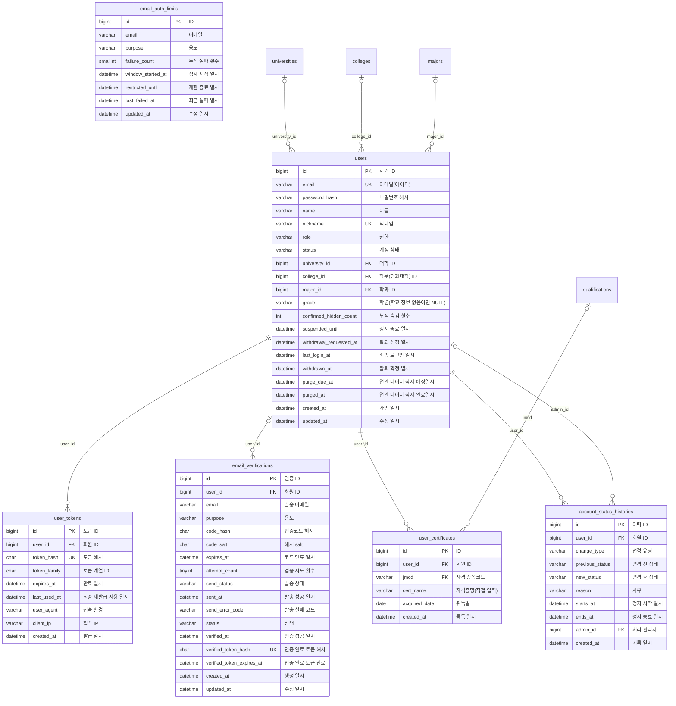
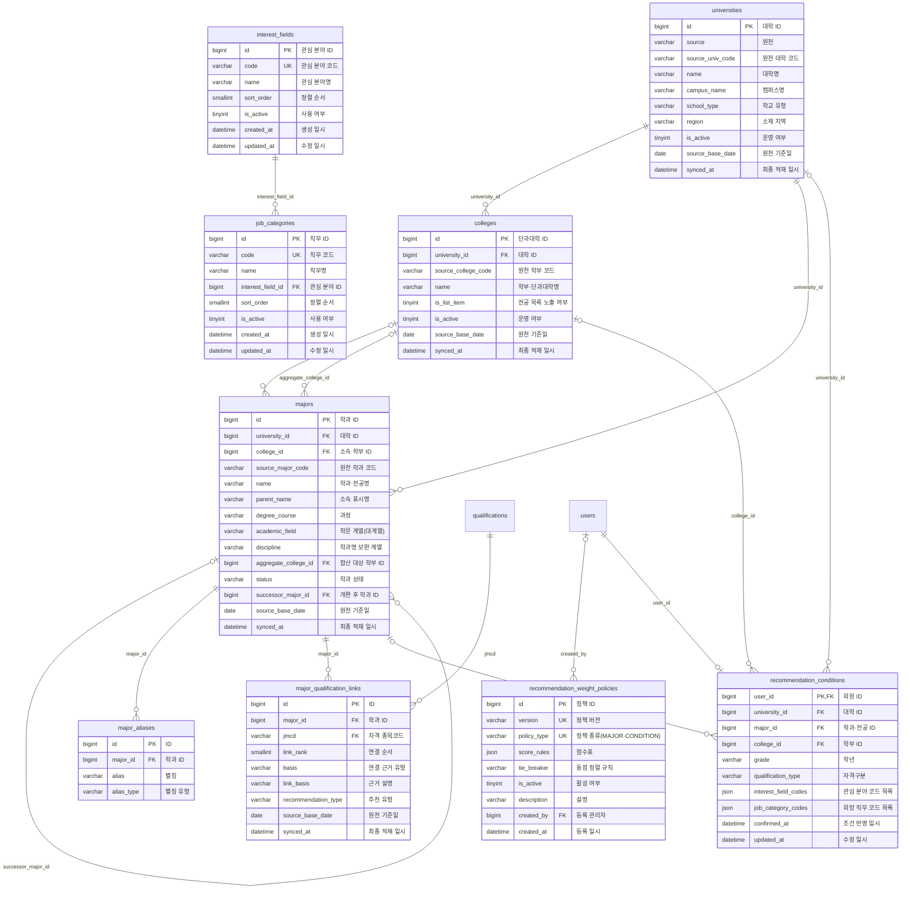
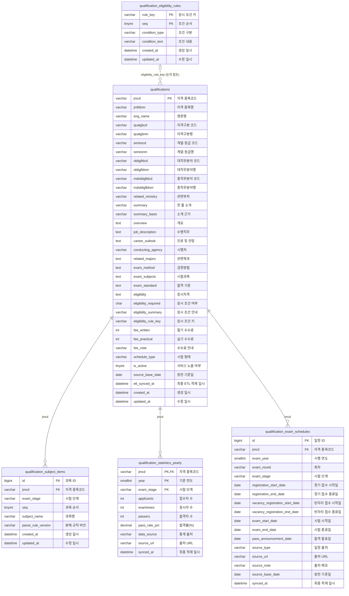
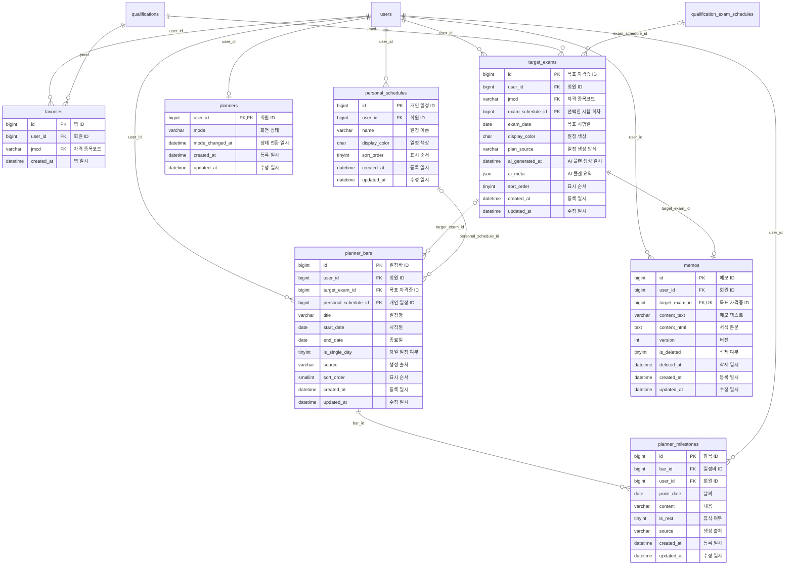
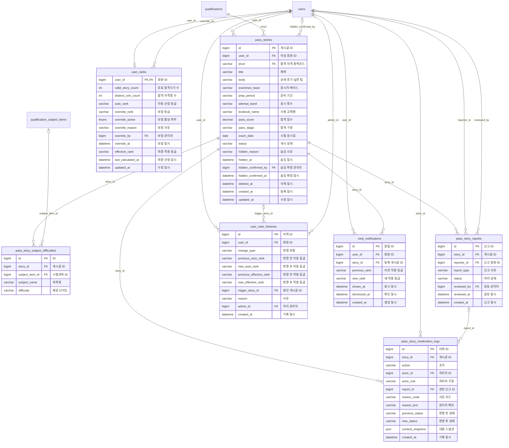
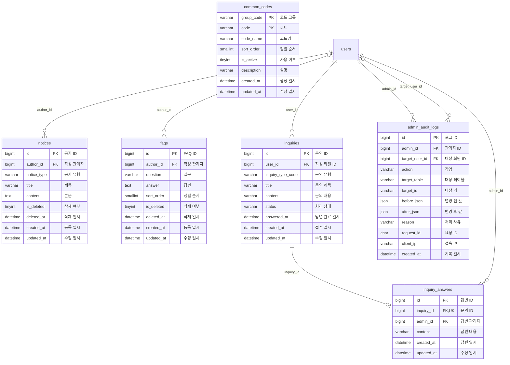

# 🗂 ERD

DB 설계서 Ver.7 기준 서비스 스키마 `jg_service` 40개 테이블입니다. 희망 직무·관심 분야는 회원정보로 저장하지 않습니다(추천 페이지 조건 선택에서만 사용). 기준 문서: 요구사항 정의서 v1.8.0 · 기능 명세서 v1.4.0. [← 처음으로](../README.md)

> `recommendation_conditions`(추천 조건)는 현재 미사용입니다. 기능 명세서 v1.4.0에서 추천 조건을 저장하지 않기로 했고, 팀 확인 전까지 구조만 남겨 둡니다.

| 쓰는 곳 | 방법 |
|---|---|
| GitHub · Notion | 아래 `mermaid` 코드 블록이 그대로 그림으로 보입니다. Notion은 코드 블록을 만들고 언어를 Mermaid로 고른 뒤 붙여 넣습니다 |
| ERD 프로그램 | [schema.sql](schema.sql)을 SQL 가져오기(ERDCloud·dbdiagram·draw.io 등)에 넣거나, MySQL에 실행한 뒤 DBeaver의 ER 다이어그램으로 엽니다 |
| 기능 ID에서 테이블 찾기 | [TRACEABILITY.md](TRACEABILITY.md) |

관계 표기: `||--o{` 1:N (부모 필수) · `|o--o{` 0..1:N (부모 선택) · `||--o|` 1:1. 선 위 이름은 자식 테이블의 FK 컬럼입니다.

## 전체 관계

```mermaid
erDiagram
    universities |o--o{ users : "university_id"
    colleges |o--o{ users : "college_id"
    majors |o--o{ users : "major_id"
    users ||--o{ user_tokens : "user_id"
    users |o--o{ email_verifications : "user_id"
    users ||--o{ user_certificates : "user_id"
    qualifications |o--o{ user_certificates : "jmcd"
    users ||--o{ account_status_histories : "user_id"
    users |o--o{ account_status_histories : "admin_id"
    universities ||--o{ colleges : "university_id"
    universities ||--o{ majors : "university_id"
    colleges |o--o{ majors : "college_id"
    colleges |o--o{ majors : "aggregate_college_id"
    majors |o--o{ majors : "successor_major_id"
    majors ||--o{ major_aliases : "major_id"
    interest_fields ||--o{ job_categories : "interest_field_id"
    majors ||--o{ major_qualification_links : "major_id"
    qualifications ||--o{ major_qualification_links : "jmcd"
    users |o--o{ recommendation_weight_policies : "created_by"
    users ||--o| recommendation_conditions : "user_id"
    universities |o--o{ recommendation_conditions : "university_id"
    majors |o--o{ recommendation_conditions : "major_id"
    colleges |o--o{ recommendation_conditions : "college_id"
    qualifications ||--o{ qualification_subject_items : "jmcd"
    qualifications ||--o{ qualification_statistics_yearly : "jmcd"
    qualifications ||--o{ qualification_exam_schedules : "jmcd"
    qualification_eligibility_rules |o..o{ qualifications : "eligibility_rule_key"
    users ||--o{ favorites : "user_id"
    qualifications ||--o{ favorites : "jmcd"
    users ||--o{ target_exams : "user_id"
    qualifications ||--o{ target_exams : "jmcd"
    qualification_exam_schedules |o--o{ target_exams : "exam_schedule_id"
    users ||--o| planners : "user_id"
    users ||--o{ personal_schedules : "user_id"
    users ||--o{ planner_bars : "user_id"
    target_exams |o--o{ planner_bars : "target_exam_id"
    personal_schedules |o--o{ planner_bars : "personal_schedule_id"
    planner_bars ||--o{ planner_milestones : "bar_id"
    users ||--o{ planner_milestones : "user_id"
    users ||--o{ memos : "user_id"
    target_exams ||--o| memos : "target_exam_id"
    users ||--o{ pass_stories : "user_id"
    qualifications ||--o{ pass_stories : "jmcd"
    users |o--o{ pass_stories : "hidden_confirmed_by"
    pass_stories ||--o{ pass_story_subject_difficulties : "story_id"
    qualification_subject_items |o--o{ pass_story_subject_difficulties : "subject_item_id"
    pass_stories ||--o{ pass_story_reports : "story_id"
    users ||--o{ pass_story_reports : "reporter_id"
    users |o--o{ pass_story_reports : "reviewed_by"
    pass_stories ||--o{ pass_story_moderation_logs : "story_id"
    users ||--o{ pass_story_moderation_logs : "actor_id"
    pass_story_reports |o--o{ pass_story_moderation_logs : "report_id"
    users ||--o| user_ranks : "user_id"
    users |o--o{ user_ranks : "override_by"
    users ||--o{ user_rank_histories : "user_id"
    pass_stories |o--o{ user_rank_histories : "trigger_story_id"
    users |o--o{ user_rank_histories : "admin_id"
    users ||--o{ rank_notifications : "user_id"
    pass_stories ||--o{ rank_notifications : "story_id"
    users ||--o{ notices : "author_id"
    users |o--o{ faqs : "author_id"
    users ||--o{ inquiries : "user_id"
    inquiries ||--o| inquiry_answers : "inquiry_id"
    users ||--o{ inquiry_answers : "admin_id"
    users ||--o{ admin_audit_logs : "admin_id"
    users |o--o{ admin_audit_logs : "target_user_id"
```

## 3장 회원·인증

## 4장 대학·학과·직무·추천

## 5장 자격증

## 6장 개인화 (찜·목표 자격증·플래너·메모)

## 7장 저격왕 (합격수기·신고·등급)

## 8장 고객센터·운영

