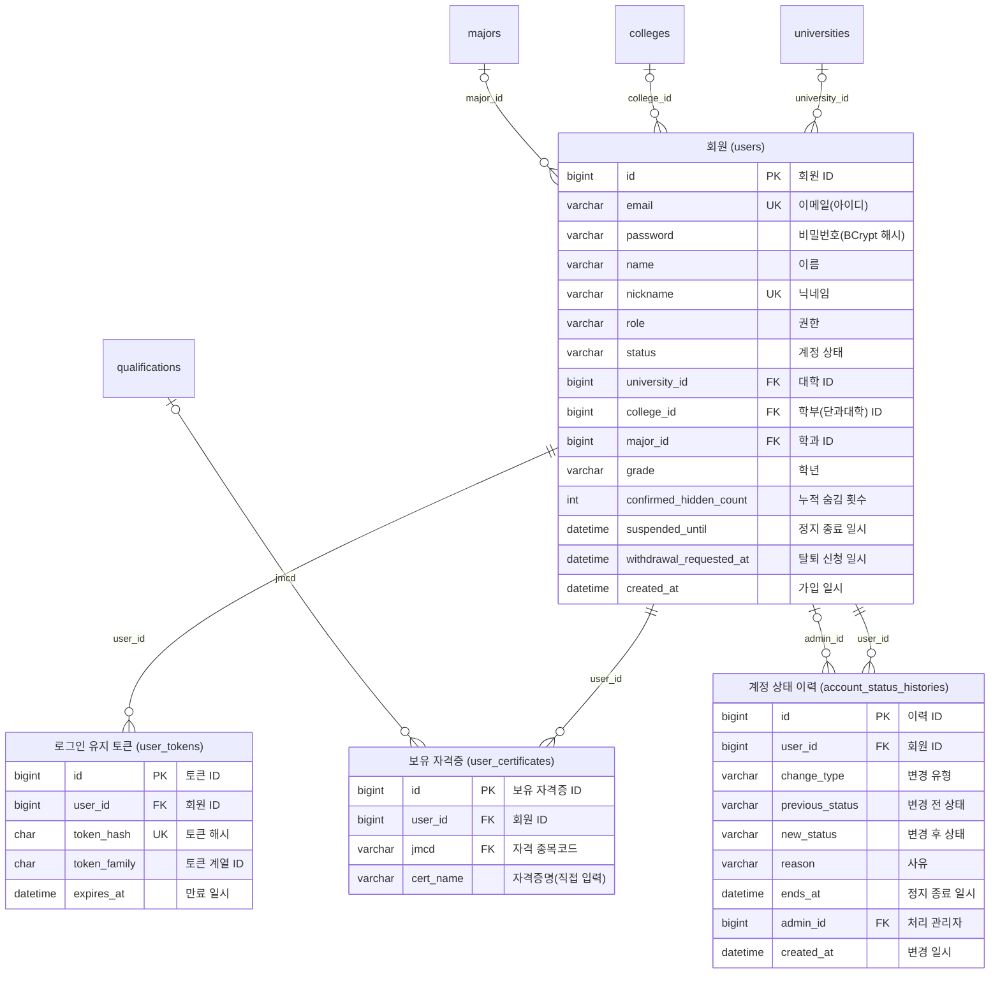
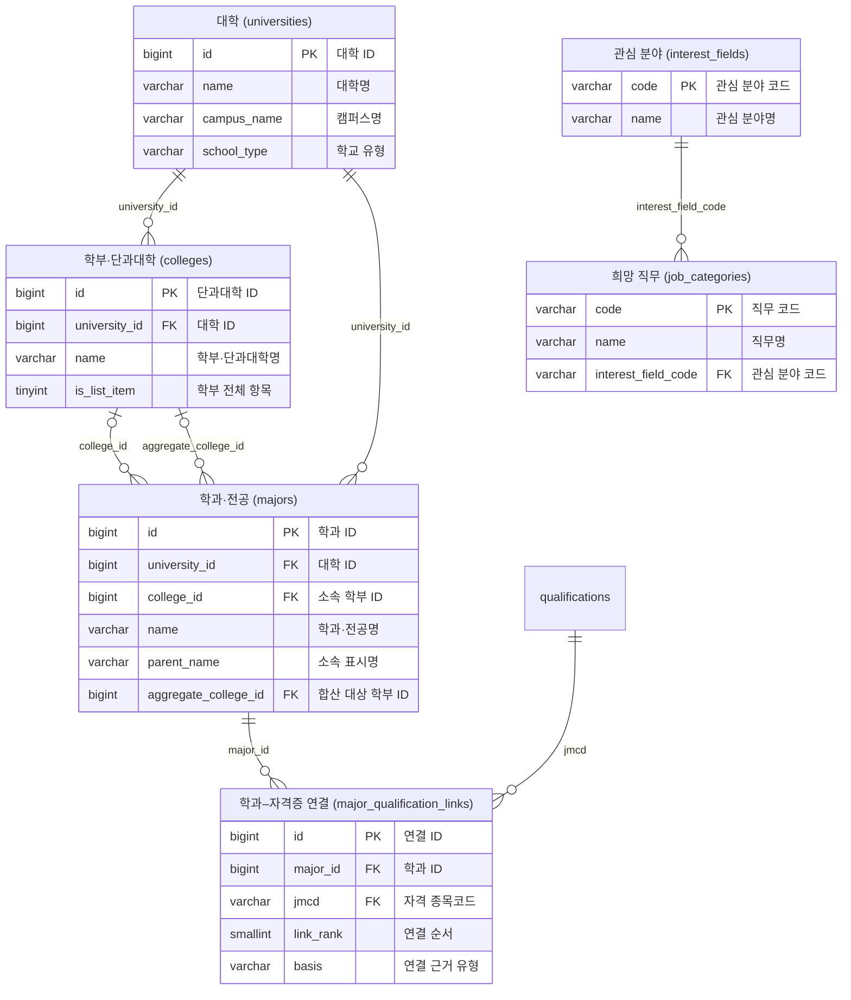
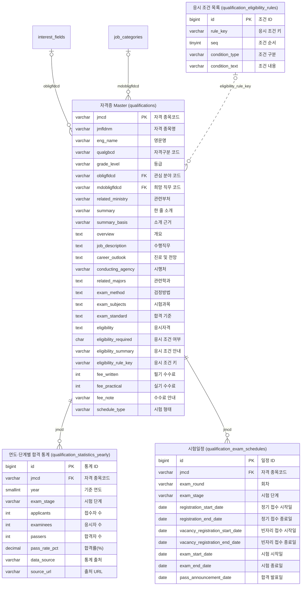
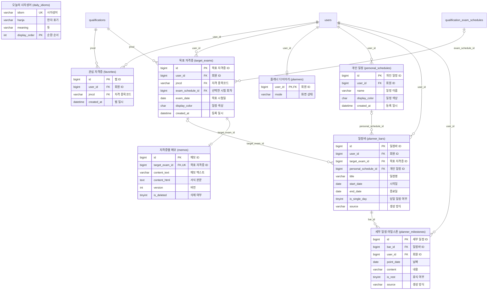
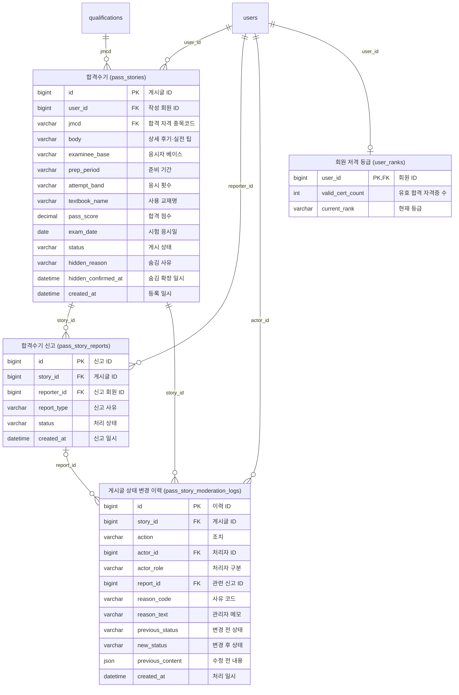
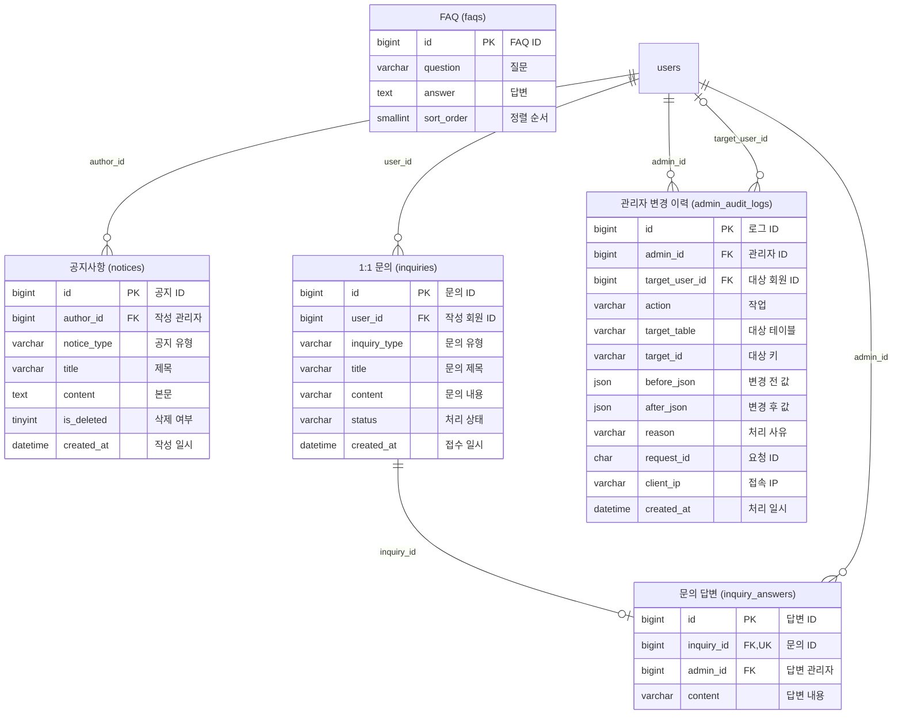

# 🗂 ERD

| 쓰는 곳 | 방법 |
|---|---|
| GitHub · Notion | 아래 `mermaid` 코드 블록이 그대로 그림으로 보입니다. Notion은 코드 블록을 만들고 언어를 Mermaid로 고른 뒤 붙여 넣습니다 |
| ERD 프로그램 | [V1__create_tables.sql](../backend/src/main/resources/db/migration/V1__create_tables.sql)을 SQL 가져오기(ERDCloud·dbdiagram·draw.io 등)에 넣거나, MySQL에 실행한 뒤 DBeaver의 ER 다이어그램으로 엽니다 |
| 기능 ID에서 테이블 찾기 | [TRACEABILITY.md](TRACEABILITY.md) |

관계 표기: `||--o{` 1:N (부모 필수) · `|o--o{` 0..1:N (부모 선택) · `||--o|` 1:1 · 점선은 논리 참조(FK 없음). 선 위 이름은 자식 테이블의 FK 컬럼입니다.

키: 모든 테이블은 단일 PK이고 FK도 단일 컬럼입니다. 이메일 인증코드는 DB에 저장하지 않습니다(백엔드 메모리).

## 전체 관계

```mermaid
erDiagram
    users["회원 (users)"]
    user_tokens["로그인 유지 토큰 (user_tokens)"]
    user_certificates["보유 자격증 (user_certificates)"]
    account_status_histories["계정 상태 이력 (account_status_histories)"]
    universities["대학 (universities)"]
    colleges["학부·단과대학 (colleges)"]
    majors["학과·전공 (majors)"]
    job_categories["희망 직무 (job_categories)"]
    interest_fields["관심 분야 (interest_fields)"]
    major_qualification_links["학과–자격증 연결 (major_qualification_links)"]
    qualifications["자격증 Master (qualifications)"]
    qualification_statistics_yearly["연도·단계별 합격 통계 (qualification_statistics_yearly)"]
    qualification_exam_schedules["시험일정 (qualification_exam_schedules)"]
    qualification_eligibility_rules["응시 조건 목록 (qualification_eligibility_rules)"]
    favorites["관심 자격증 (favorites)"]
    target_exams["목표 자격증 (target_exams)"]
    planners["플래너 다이어리 (planners)"]
    personal_schedules["개인 일정 (personal_schedules)"]
    planner_bars["일정바 (planner_bars)"]
    planner_milestones["세부 일정·마일스톤 (planner_milestones)"]
    memos["자격증별 메모 (memos)"]
    daily_idioms["오늘의 사자성어 (daily_idioms)"]
    pass_stories["합격수기 (pass_stories)"]
    pass_story_reports["합격수기 신고 (pass_story_reports)"]
    pass_story_moderation_logs["게시글 상태 변경 이력 (pass_story_moderation_logs)"]
    user_ranks["회원 저격 등급 (user_ranks)"]
    notices["공지사항 (notices)"]
    faqs["FAQ (faqs)"]
    inquiries["1:1 문의 (inquiries)"]
    inquiry_answers["문의 답변 (inquiry_answers)"]
    admin_audit_logs["관리자 변경 이력 (admin_audit_logs)"]
    universities |o--o{ users : "university_id"
    colleges |o--o{ users : "college_id"
    majors |o--o{ users : "major_id"
    users ||--o{ user_tokens : "user_id"
    users ||--o{ user_certificates : "user_id"
    qualifications |o--o{ user_certificates : "jmcd"
    users ||--o{ account_status_histories : "user_id"
    users |o--o{ account_status_histories : "admin_id"
    universities ||--o{ colleges : "university_id"
    universities ||--o{ majors : "university_id"
    colleges |o--o{ majors : "college_id"
    colleges |o--o{ majors : "aggregate_college_id"
    interest_fields ||--o{ job_categories : "interest_field_code"
    majors ||--o{ major_qualification_links : "major_id"
    qualifications ||--o{ major_qualification_links : "jmcd"
    interest_fields |o--o{ qualifications : "obligfldcd"
    job_categories |o--o{ qualifications : "mdobligfldcd"
    qualifications ||--o{ qualification_statistics_yearly : "jmcd"
    qualifications ||--o{ qualification_exam_schedules : "jmcd"
    users ||--o{ favorites : "user_id"
    qualifications ||--o{ favorites : "jmcd"
    users ||--o{ target_exams : "user_id"
    qualifications ||--o{ target_exams : "jmcd"
    qualification_exam_schedules |o--o{ target_exams : "exam_schedule_id"
    users ||--o| planners : "user_id"
    users ||--o{ personal_schedules : "user_id"
    users ||--o{ planner_bars : "user_id"
    target_exams |o--o{ planner_bars : "target_exam_id"
    personal_schedules |o--o{ planner_bars : "personal_schedule_id"
    planner_bars ||--o{ planner_milestones : "bar_id"
    users ||--o{ planner_milestones : "user_id"
    target_exams ||--o| memos : "target_exam_id"
    users ||--o{ pass_stories : "user_id"
    qualifications ||--o{ pass_stories : "jmcd"
    pass_stories ||--o{ pass_story_reports : "story_id"
    users ||--o{ pass_story_reports : "reporter_id"
    pass_stories ||--o{ pass_story_moderation_logs : "story_id"
    users ||--o{ pass_story_moderation_logs : "actor_id"
    pass_story_reports |o--o{ pass_story_moderation_logs : "report_id"
    users ||--o| user_ranks : "user_id"
    users ||--o{ notices : "author_id"
    users ||--o{ inquiries : "user_id"
    inquiries ||--o| inquiry_answers : "inquiry_id"
    users ||--o{ inquiry_answers : "admin_id"
    users ||--o{ admin_audit_logs : "admin_id"
    users |o--o{ admin_audit_logs : "target_user_id"
    qualification_eligibility_rules |o..o{ qualifications : "eligibility_rule_key"
```

## 3장 회원·인증

## 4장 대학·학과·직무·추천

## 5장 자격증

## 6장 개인화 (찜·목표 자격증·플래너·메모)

## 7장 저격왕 (합격수기·신고·등급)

## 8장 고객센터·운영

