# 저격증 플로우차트

* 실선: 화면 이동 · 점선: 화면 이동이 아닌 연결(서버 응답·데이터 공유·판단 참고)
* 괄호 안: 화면 ID · 담당

## 전체 흐름

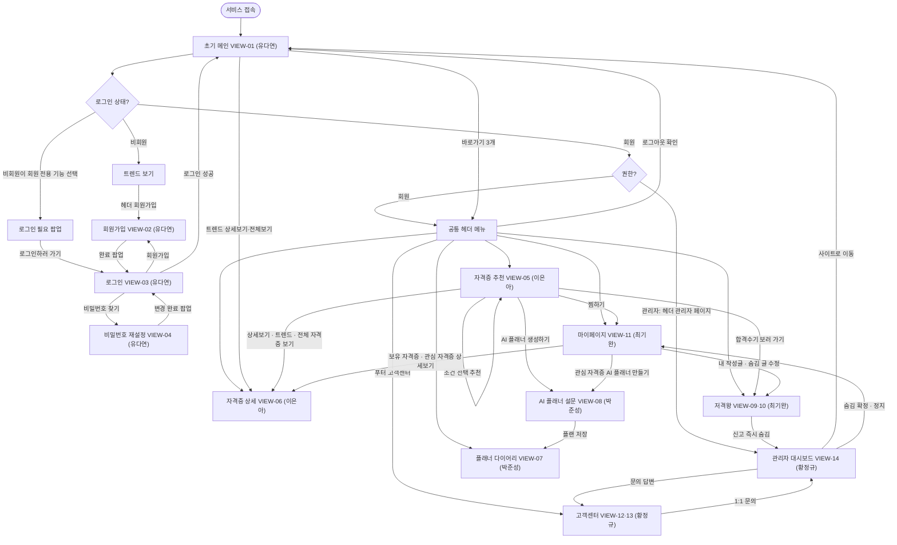

## 0. 공통 헤더 및 초기 화면 (CF-00-01~04)

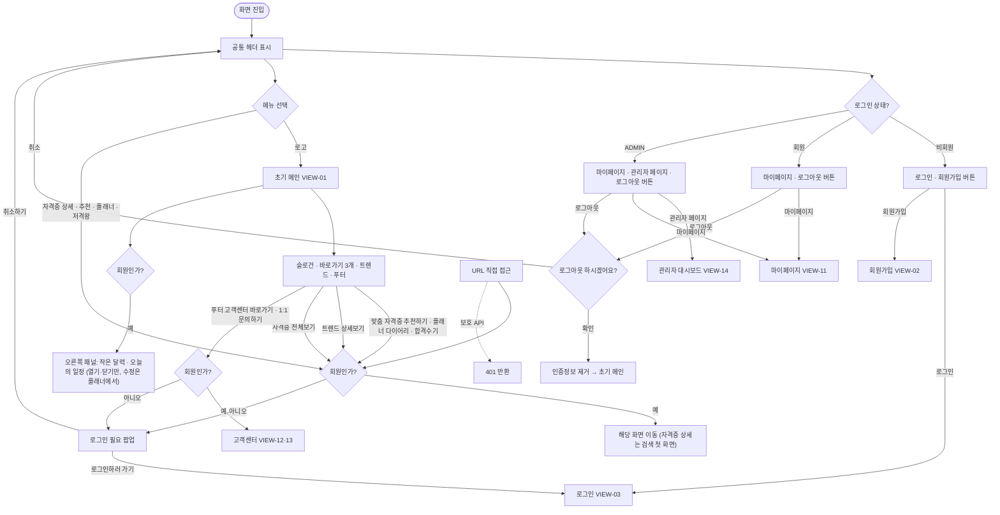

## 1. 회원 관리 (AUTH-01~06)

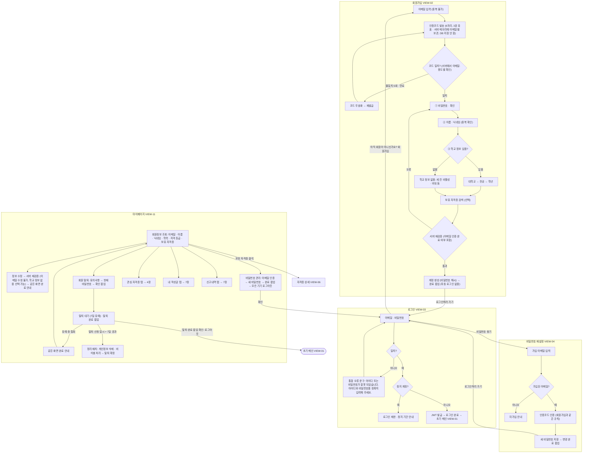

## 2. 자격증 추천 (CF-01-01~12)

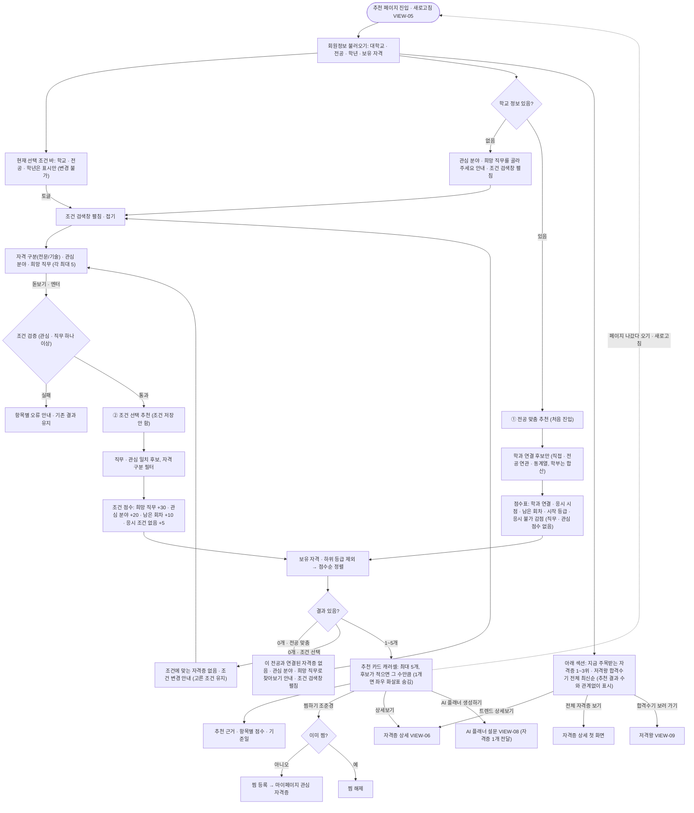

## 3. 자격증 상세 (CF-02-01~06·08~10, 조회 전용)

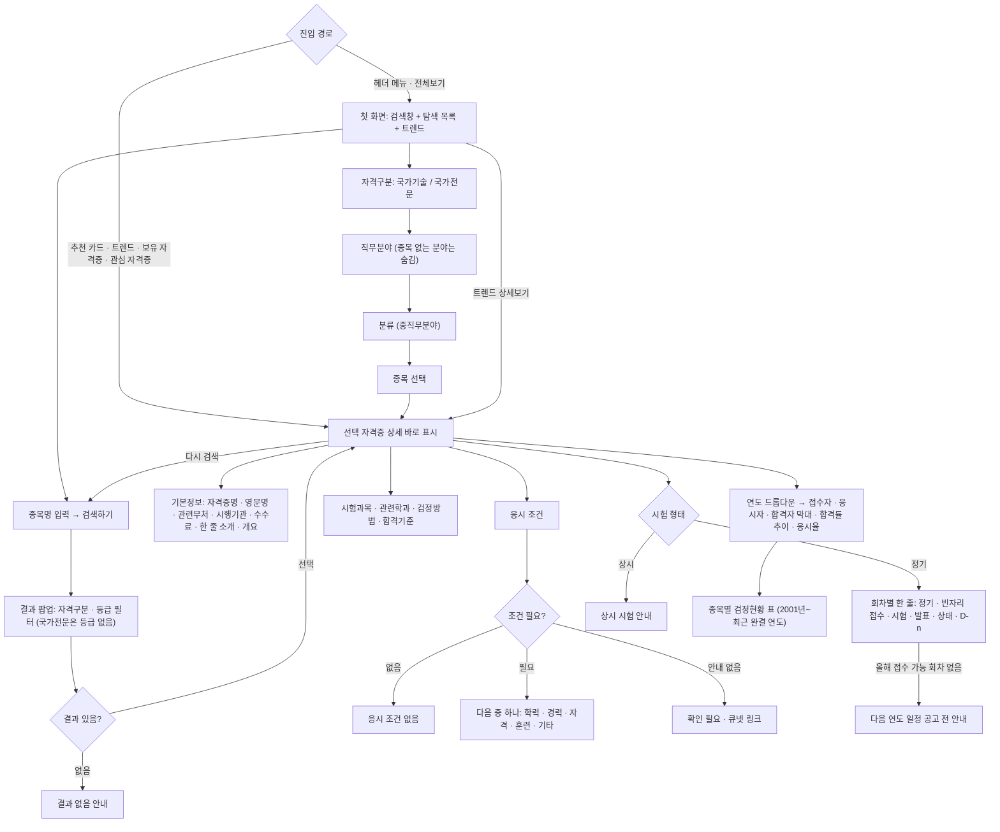

## 4. 찜 · 관심 자격증 · D-Day (CF-03-01~04, 09)

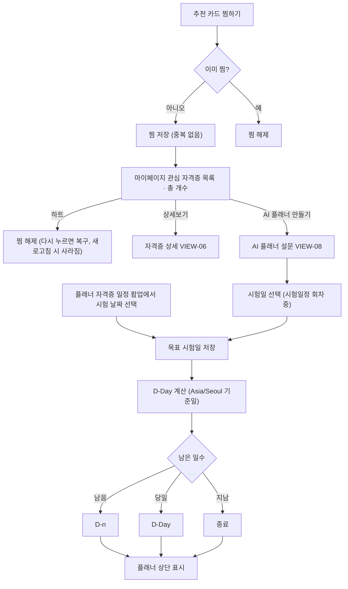

## 5. 플래너 다이어리 (CF-04-01~19)

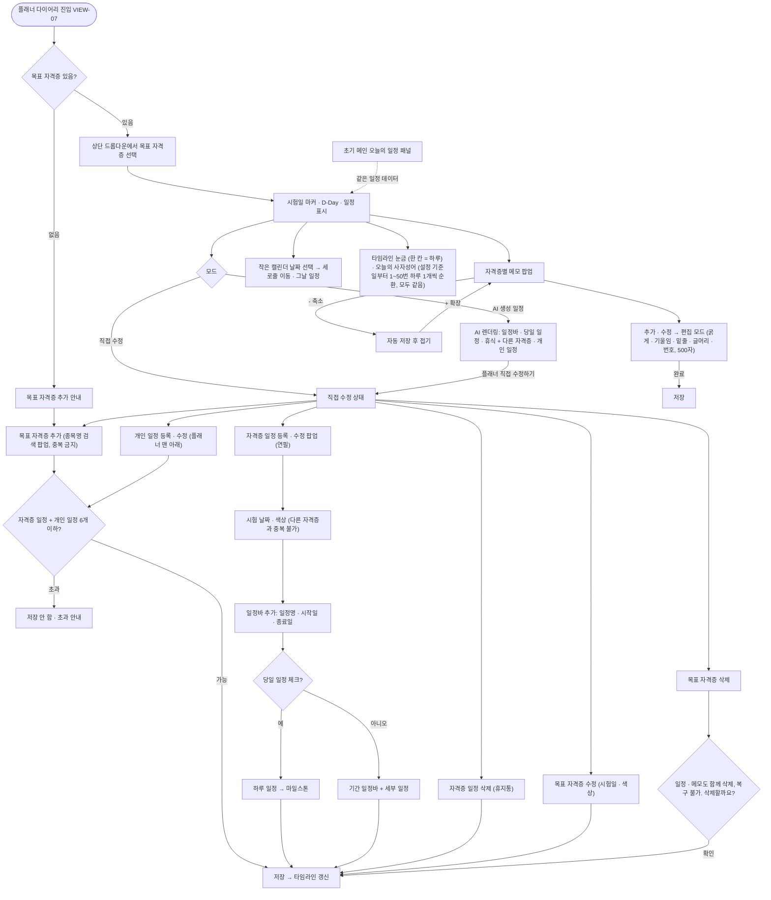

## 6. AI 플래너 생성 (CF-06-01~05)

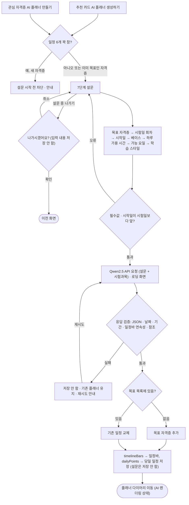

## 7. 저격왕 합격수기 게시판 (CF-05-01~13)

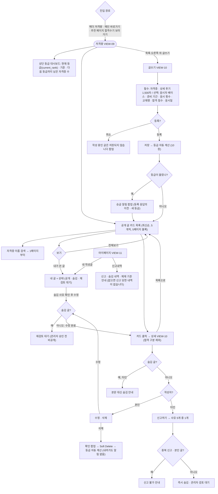

## 8. 관리자 기능 (ADMIN-02~11)

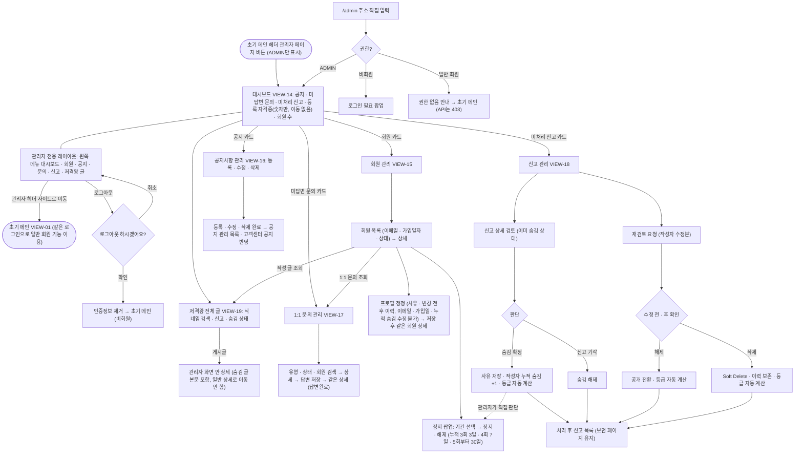

## 9. 고객센터 (CS-01~05)

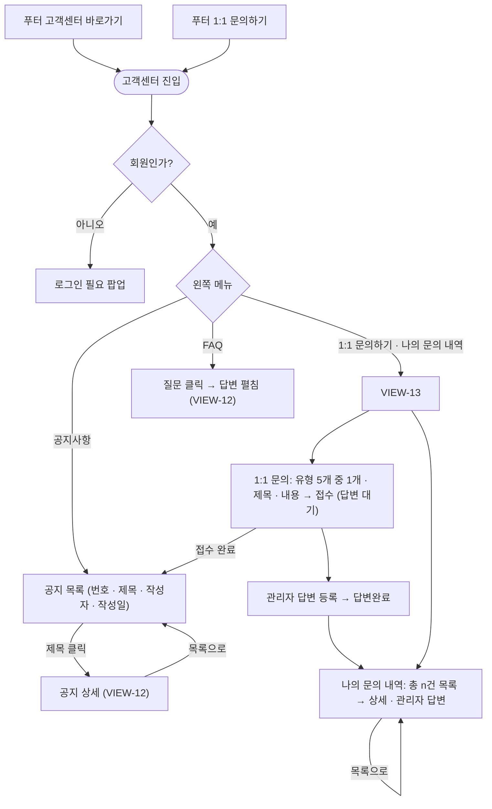

## 10. 저격 등급 자동 계산 (CF-05-04·12, 관리자 보정 없음)

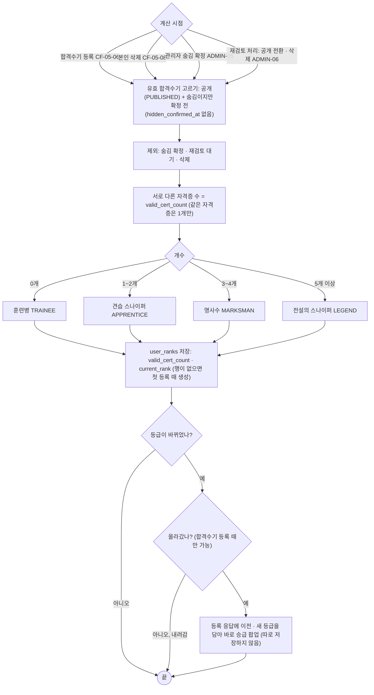
